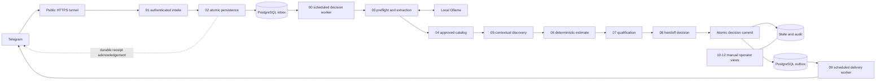

# Architecture

Intake acknowledgement is separate from a completed AI decision or sent reply.
Commands and clear pending-question answers skip AI; open-ended messages receive
strict extraction validation. Code controls questions, estimates, and scoring.
An outbox preserves delivery ordering and quarantines uncertain sends for review.

See [architecture and lifecycle](../docs/architecture-lifecycle.md) for workflow
responsibilities and [database guide](../docs/database-guide.md) for the transaction
and lease protocol. This diagram does not imply a full live sales journey has
passed acceptance testing.
