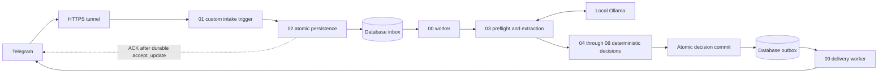

# Architecture and lifecycle

Current implementation note (2026-10-15): memory/discovery fixes are deployed.
Besides commands, clear answers to pending manual-setup, order-entry, and common
platform-selection questions bypass AI after safety checks. Other messages use
validated local extraction. An explicit no-app answer is stored separately from
the future platform. Desired-outcome answers do not reclassify the saved task.
The deployment-pending wording in the historical narrative below is superseded
by the [current verification record](verification-record-2026-10-15.md).

PostgreSQL owns durable state and approved business data. Local Ollama extracts facts; deterministic code selects questions, applies policy, calculates ranges and prepares replies. Telegram and Cloudflare carry traffic outside the local machine.

| Number | Builder name | Responsibility |
|---|---|---|
| 00 | Pre-Sales Orchestrator | Claim inbox, call 03–08, commit decision; scheduled every 5 seconds |
| 01 | Telegram Intake Adapter | Latest approach: custom encrypted-credential trigger, normalize private human messages, call 02, ACK after durable intake |
| 02 | Customer and Conversation Persistence | Atomic intake and duplicate recognition |
| 03 | Intent and Requirement Extraction | Native command preflight; strict extraction with at most one repair |
| 04 | Service and Knowledge Search | Match approved catalog category; route unsupported scope to review |
| 05 | Discovery Question Manager | Ask one missing question, then request `/confirm` |
| 06 | Deterministic Estimate Builder | Approved service ranges and eligible adjustments; no package totals |
| 07 | Lead Qualification | Approved deterministic weights after consent and contact |
| 08 | Human Handoff | Finalize decision and structured local review request |
| 09 | Telegram Response Adapter | Claim outbox every 3 seconds, escape text, use retained native Telegram send node and record outcome |
| 10 | Service Catalog Administration | Manual catalog inspection; not a public editing endpoint |
| 11 | Analytics and Audit | Manual aggregate inquiry, lead, handoff and queue counts |
| 12 | Failure Retry and Replay | Manual failed-work inspection; replay uses operator tools |

The builder creates 13 credential-free, inactive exports with IDs `p06Workflow00` through `p06Workflow12`. It disables saved success/error execution data and manual execution saving. Import succeeded and internal 02–08 are published; native command, estimate and local Ollama CRM discovery smoke tests passed. Reload and initial live processing are verified. All 13 exports validate inactive and credential-free; exported inactivity is separate from active runtime 00–09. Final revised engine deployment confirmation remains pending. Preserve the separate learning workflow inactive.

The latest intake design requires a custom Telegram trigger with `responseMode: lastNode`, using the existing encrypted `telegramApi` credential. For supported updates, 01 must wait for 02 and the durable `presales.accept_update` result before returning a successful webhook acknowledgement. Duplicate updates may be acknowledged after database duplicate recognition. A database failure must not produce an early successful ACK; unsupported-update handling must be deliberate and tested. ACK confirms receipt, not a completed estimate or Telegram reply. Long-running AI work remains in 00, outside the intake request.

The custom node is persisted at `/home/node/.n8n/custom/P06TelegramIntake.node.js` and verified reloaded. Runtime 00–09 are active; 10–12 are manual. Local/public invalid-authentication checks return 403; initial live greeting/discovery replies are confirmed sent. A temporary standard native Webhook (`lastNode`) plus PostgreSQL probe passed: HTTP 200 took about 1.1 seconds after `pg_sleep(1)`, and database failure returned HTTP 500. The probe was unpublished afterward. This verifies the standard `lastNode` mechanism, not an authenticated custom-intake database-outage scenario. Keep private webhook material and owner identifiers out of artifacts.

Native commands, including `/confirm`, pass through preflight without model generation. Other text requests structured facts from `qwen2.5:3b`; invalid output gets one repair attempt in workflow 03. Low confidence, conflicts and review requests produce a controlled handoff. Raw model text is never the customer response. FAQs currently use normalized exact-question matching, not semantic search.

The worker merges explicit facts into working requirements. Discovery asks about the problem, category, applications, daily volume, features and timeline; repeated misunderstanding escalates. Corrections invalidate pending confirmation. `/confirm` permits calculation only when a summary is pending and required facts are present. It does not approve a final quotation or delivery date.

Inbox lifecycle: `pending → processing → completed`, with `retry_wait` or `dead_letter` on failure. Outbox lifecycle: `pending → processing → sent`, with `retry_wait` only for confirmed retryable failure. Uncertain delivery becomes a dead letter. Inbox claims carry a 600-second lease; sender/outbox claims carry a 120-second lease. Both carry a token; stale workers cannot commit. Processing is ordered within a conversation and delivery within a destination chat.

One decision transaction stores state, optional estimate/lead/ticket, audit event and one customer outbox reply. Owner notification is a separate job when privately configured. Conversations normally return to `awaiting_customer` or remain `handed_off`. `/reset` clears working requirements but does not resolve a handoff. Do not present every status in the earlier lifecycle design as an exercised transition.

Teaching note: an inbox separates receiving from thinking; an outbox separates deciding from sending. Database duplicate prevention protects records. It cannot guarantee exactly-once Telegram delivery after a crash or an uncertain network response, now or in a future deployment.
