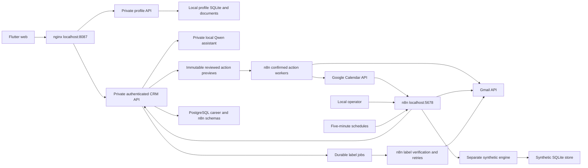

# Architecture

Workflow 06 imports a bounded seven-day career-email window, follows pagination and skips duplicates. Workflow 07 separately delivers and verifies managed labels. Uncertain identity stays in review. Real application data is shared between Flutter and workflows through the CRM API. Profile uploads are separate; Drive links do not establish Google Drive account access.

## Review, actions and durability

Authenticated review decisions lock and version-check the message and application, record the decision and evidence, then queue the current managed labels. The HTTP response is sent only after commit. A label worker acknowledges delivery only after Gmail readback with the matching generation and lease.

Actions are separate persisted records with optional Manila due dates and revision checks. Completion adds history without changing an application stage. The Connections screen reads completion timestamps, published-workflow state and delivery failures from the same API.

Private backups capture PostgreSQL, the profile SQLite/file folder, n8n state, synthetic engine data and the original environment keys while writers are stopped. Isolated restore verification compares counts and checks document integrity. Public release artifacts contain only source, built client assets and sanitized evidence.

## Workspace 1.1

Original confirmation timestamps supply submission dates independently of later stage changes. Linked email text, searchable descriptions, profile photos and calendar records are served through authenticated routes. Worker 09 imports a complete bounded Calendar window before claiming confirmed bookings; worker 08 claims only the connected Gmail account's confirmed replies. Booking retries reuse event IDs. Uncertain email sends stop for review. Ollama receives bounded local context and can return only information/proposals; it cannot call the confirmation endpoint.
