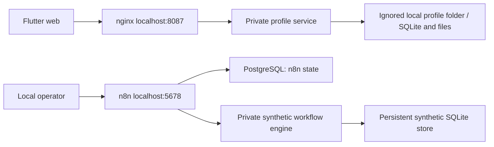

# Architecture

Application editing remains in browser memory. The Flutter CRM is not yet connected to the workflow engine. Gmail OAuth and live labels remain pending. Profile files are stored separately from application data.
