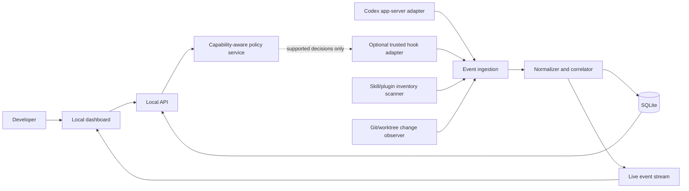

# Agent Control Center — architecture proposal

Status: design baseline with Sprints 0–5 technical implementation, updated 2026-10-31. Current behavior and boundaries are documented in README.md, qa-report.md and release-report.md. Human pilot timing and later cloud/multi-agent/control phases remain unvalidated or proposed.

## Product intent

Give developers a live, evidence-backed debugger for AI coding runs. A developer can choose the skills/plugins intended for a task, watch the project take shape, pause on a failure, and inspect the exact event, tool result, file change, and test that explains it. The animated construction view is a navigation and comprehension layer over an event timeline, never a generated story about unobserved work.

## Decisions and assumptions

- First adapter: Codex, because it is the runtime named in the target workflow. Validate the exact app-server and hook capabilities against the installed release during Sprint 0. Claude Code is the second adapter.
- Deployment: local collector and browser dashboard. All run data stays local by default. Multi-user cloud sync is outside the MVP.
- Entry mode: connect to an existing Codex run through supported events where available. If some events require a client-owned app-server session, offer a clearly labeled "Launch with Control Center" mode; do not claim that arbitrary desktop sessions are fully observable.
- In launch mode the developer enters the prompt and chooses an **expected set** of skills/plugins. The dashboard passes the prompt to Codex, records the set, and verifies the selected components are available before launch. It does not force Codex to invoke them. For an externally started run, the dashboard can record an expected set for comparison but cannot claim it submitted the prompt.
- Read-only observation first. Controls that change agent configuration or block actions appear only after a capability-specific enforcement test.
- The dashboard reports private reasoning as unavailable. It never attempts to reconstruct or display it.

## Competitive position

Skillmgmnt already covers cross-agent skill inventory, load topology, and usage from logs. Agent HUD manages project skill/plugin state. Agent Flight Recorder records coding-agent runs and diffs. Langfuse, Phoenix, and AgentOps are strong at tracing and debugging. The proposed distinction is a **causal, developer-facing link** among declared skill availability, observed skill activation, tool actions, file diffs, test outcomes, and enforceable controls, with evidence and uncertainty visible at every step. This is a product hypothesis to validate, not a claim that competitors lack every element.

## System context

## Components and boundaries

1. **Adapter contract.** Each adapter declares supported observations and controls separately: `session`, `turn`, `tool_start`, `tool_end`, `skill_load`, `skill_invoke`, `file_write`, `approval`, `test_result`, `cancel`, `policy_preflight`. A capability record includes source, version, latency class, and whether the signal is direct or inferred. Unsupported capabilities are visible in the UI.
2. **Inventory scanner.** Discovers configured skills and plugins from supported Codex locations and manifests, records scope, path, origin, content hash, version if supplied, and effective availability. It treats skill, plugin, MCP tool, and instruction file as distinct entities. It never runs code discovered during scanning.
3. **Collector.** Receives adapter events through a local authenticated endpoint or embedded process channel. It persists raw event envelopes, assigns an ingest timestamp and monotonic sequence, deduplicates by source event ID, and survives UI disconnection. Bounded queues and backpressure prevent an active run from exhausting memory.
4. **Normalizer/correlator.** Produces canonical events with `run_id`, `session_id`, `turn_id`, `parent_id`, `actor_id`, `source_id`, `event_type`, `observed_at`, `ingested_at`, `status`, `evidence_level`, and typed payload. Correlation is deterministic where IDs exist; heuristic joins must carry a reason and confidence label. Preserve a sanitized source envelope for audit. A skill load alone never proves that subsequent tool calls were caused by that skill; that link needs explicit runtime IDs, otherwise label it temporal correlation.
5. **Change observer.** On a Git-backed project, captures baseline commit/index/worktree state, then associates changed files and hunks with run intervals. A diff is an observed artifact; attribution to a particular skill is confirmed only if an event identifies the action. External edits, concurrent agents, and dirty starting worktrees remain distinct and may be unattributed. Never auto-reset or roll back files.
6. **Failure classifier.** Connects tool errors, process exits, test failures, policy denials, timeouts, and interrupted runs to the event that produced them. It does not use an LLM to invent root causes. Optional AI explanation can be added later and visibly labeled as analysis.
7. **Policy service.** Stores desired rules and the adapter capability that could enforce each one. In MVP it may show configuration drift and expected-versus-observed skill sets. Blocking and permission controls are enabled only after end-to-end tests prove that the selected runtime calls the policy before the action. Fail-open/fail-closed behavior must be explicit per rule.
8. **Local API.** Read endpoints for runs, events, inventory, diffs, and evidence; local server-sent events for live updates. Mutating endpoints require local authentication and CSRF protection. No remote listener by default.
9. **Visualization.** A deterministic renderer maps event types to construction-site metaphors. Workers represent skills, tools, and agents with different shapes; a building zone represents a feature or file group. Animation is driven by the same event IDs as the timeline, so clicking any visual opens its evidence. Unknown work is shown as an unassigned activity, not silently given to a skill.

## Canonical data model

| Entity | Essential fields | Purpose |
|---|---|---|
| `agent_connection` | id, runtime, version, mode, capabilities | Describes what this integration can observe/control |
| `component` | id, kind, name, origin, scope, hash, status | Skill/plugin/MCP tool inventory |
| `run` | id, connection_id, workspace, start/end, status, expected_set | One inspectable build attempt |
| `event` | id, run_id, parent_id, source, time, sequence, type, status, evidence | Append-only execution record |
| `artifact_change` | id, run_id, path, before/after hash, diff_ref, attribution | File-level result |
| `policy_rule` | id, scope, condition, action, enforcement_mode | Desired guardrail |
| `policy_decision` | id, event_id, rule_id, outcome, evidence | Actual policy application |

Raw prompts and tool inputs/outputs are off by default. Metadata-only capture includes names, statuses, durations, hashes, and paths relative to the workspace. The collector sanitizes each incoming source envelope **before its first disk write**, then persists that sanitized envelope and the normalized projection. If full payload capture is enabled, known secrets are redacted before persistence, content is size-limited, and the capture setting is shown in the UI. Unknown secrets can evade pattern-based redaction, so full capture is explicitly opt-in and never required for the MVP. Define retention and export/delete controls before real-world use.

## Real-time interaction model

The primary screen has three synchronized panes: **Build Scene**, **Event Timeline**, and **Inspector**. The scene shows active workers, affected zones, and blocked tasks. The timeline is the authoritative ordered record. The inspector shows raw/normalized event, parent-child context, input/output when captured, diff, test result, and evidence label. The user can pause the visual playback without stopping Codex, scrub historical events, jump to a failure, filter by skill/tool/file, and switch to a dense table view. A separate explicit action is required to cancel a run.

Animation states: `available -> observed_start -> active -> success | failure | cancelled | unknown_end`; `waiting_approval` and `blocked_by_policy` are side states. No animation moves a worker from start to success merely because time elapsed. Delayed/out-of-order events update the timeline and scene with a visible late-event marker. If live connection drops, the scene freezes and reports the last received event time.

## Failure drill-down contract

For a failed event, show (1) exact failed operation and timestamp, (2) source runtime and raw evidence, (3) parent operation and preceding events, (4) stdout/stderr or structured error when available, (5) files changed before/after, (6) tests run and outcomes, (7) whether policy/approval intervened, and (8) whether attribution is direct, correlated, or unknown. Allow export of a redacted diagnostic bundle.

## Security and reliability

- Bind the local server to loopback and use an ephemeral session token; never expose a network endpoint by default.
- Treat skill files, tool output, logs, and prompts as untrusted data; render as text and sanitize markup.
- Installation or enable/disable operations require a preview of exact file/config changes and an explicit user action.
- Protect source content: metadata capture by default, opt-in full payloads, retention controls, redaction, encrypted storage where supported.
- Persist sanitized source envelopes before projection; make replay idempotent. Resume after restart without duplicate events.
- Distinguish event time from receipt time; tolerate missing, duplicated, late, and out-of-order events.

## Proposed stack

Implemented MVP: dependency-free ESM JavaScript on Node.js 22.13+, built-in SQLite with migrations, built-in HTTP/SSE, Git CLI read-only snapshots, and browser JavaScript with SVG/CSS animation. TypeScript and React were considered but deferred to keep the local source release simple and avoid registry dependencies. The adapter separates Codex event names from canonical events. PostgreSQL, Redis, and WebSockets remain unnecessary for this local MVP.

## Architecture options considered

- **Local collector (chosen proposal):** quickest path to trustworthy run evidence and privacy; limits team collaboration initially.
- **Hosted cloud service:** useful for teams, but requires account, tenancy, data handling, and secure remote transport before the core debugger is proven.
- **Universal tool gateway:** could enforce policies, but cannot intercept tools that bypass it; too intrusive as the only first integration.

## Acceptance criteria for the architecture

An instrumented Codex run appears within two seconds of a received event on a normal local machine; replay yields the same state as the live view; a failure can be traced to its source event and affected diff; every skill-use claim carries an evidence label; unsupported controls are never presented as active; and disconnect/restart does not lose persisted events. These are targets to test, not measured claims.

## Open decisions before implementation

1. Validate whether the installed Codex app-server can attach to existing desktop sessions. If not, limit the first release to client-owned launches and document the boundary.
2. Confirm which hook events and payload fields expose skill loads, tool calls, and approval decisions on the target Codex version.
3. Decide whether the initial product is Windows-first or cross-platform. The current workspace is Windows; the architecture keeps platform-specific scanning inside adapters.
4. Decide whether a developer can launch Codex from the dashboard in MVP or only connect to a running session.

## Sources consulted

- [Codex app-server protocol](https://github.com/openai/codex/blob/main/codex-rs/app-server/README.md) and [Codex as a platform](https://developers.openai.com/blog/codex-as-a-platform)
- [Codex plugin hooks](https://developers.openai.com/plugins/build/plugins) and [Skills](https://developers.openai.com/plugins/concepts/skills)
- [OpenTelemetry GenAI conventions](https://opentelemetry.io/docs/specs/semconv/registry/attributes/gen-ai/)
- [Skillmgmnt](https://github.com/hcodestack/skillmgmnt), [Agent HUD](https://github.com/ganggangstone/agent-hud), [Agent Flight Recorder](https://github.com/AgentOpsSec/agent-flight-recorder)
- [Langfuse observability](https://github.com/langfuse/langfuse-docs/blob/main/content/docs/observability/overview.mdx), [Phoenix](https://github.com/arize-ai/phoenix), [AgentOps](https://github.com/AgentOps-AI/agentops)
